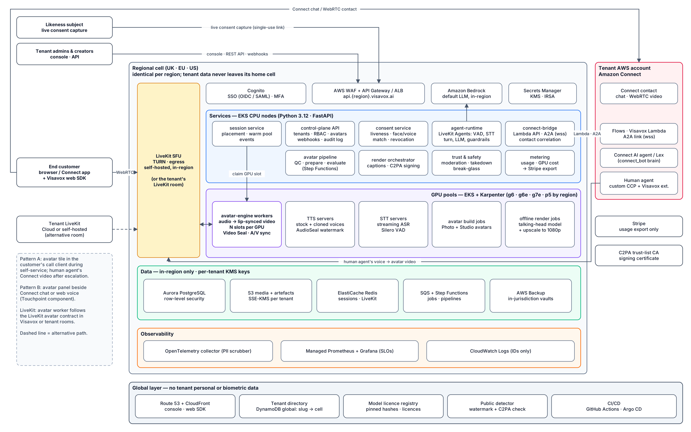

# Visavox — Software Design Document

| Field | Value |
|---|---|
| Version | 1.0 |
| Date | 2026-10-17 |
| Status | **FROZEN 2026-10-17** (approved by the owner in PR #1) |
| Requirements | [`REQUIREMENTS.md`](REQUIREMENTS.md) v1.0 |
| Rules | [`CLAUDE.md`](CLAUDE.md) |

This document says **how** Visavox meets `REQUIREMENTS.md`. Requirement IDs in brackets (e.g. [RT-03]) show where each design element comes from; §13 traces every requirement group to design sections and delivery nodes. Research behind the design decisions was done on 2026-10-17 and is cited in §10 and Appendix A; every external claim marked *(verify in Sx)* is confirmed or overturned by the named spike before dependent build work starts.

*Source: [`docs/diagrams/visavox-architecture.drawio`](docs/diagrams/visavox-architecture.drawio) · PDF: [`docs/diagrams/visavox-architecture.pdf`](docs/diagrams/visavox-architecture.pdf)*

## 1. Design principles

1. **One engine, many drivers and transports.** A single real-time avatar engine turns a stream of speech audio into synchronised audio + video. AI agents, human voices and external agents only differ in where that audio comes from; LiveKit and Connect only differ in where the result is published. Offline rendering reuses the avatar assets and voices with a quality-optimised model.
2. **LiveKit is the internal media backbone.** Every live Visavox session runs as participants in a LiveKit room — either the tenant's room or a Visavox-hosted room in the tenant's region. Connect integrations bridge into that room rather than building a second media stack.
3. **Cells, not a global data plane.** Each region is an identical, independent cell holding all tenant data for tenants homed there [TEN-02]. The global layer holds only routing and non-personal tenant metadata.
4. **Consent is a hard runtime gate, not a form.** The engine itself refuses to load an avatar or voice without a valid, in-scope consent token [AVA-04, CON-03].
5. **Licence-clean by construction.** Every model and weight file is pinned, hashed and recorded in the model licence registry; CI fails on anything unregistered or non-commercial [NFR-S6].
6. **Spec → failing test → code.** Every change starts from a requirement ID and a failing test (see `CLAUDE.md`).

## 2. System context

| External system | Interaction |
|---|---|
| Amazon Connect (tenant's instance, tenant's AWS account) | Pattern A video contacts and pattern B chat/voice contacts; cross-account role created by tenant [CNA, CNB] |
| LiveKit Cloud or tenant self-hosted LiveKit | Avatar worker and AI agent join tenant rooms as participants [LK] |
| End-customer browser / Connect mobile SDK | Receives avatar media over WebRTC |
| Amazon Bedrock (tenant region) | Default LLM for built-in AI agent (A-01); tenants may point to another LLM endpoint |
| Tenant IdP | OIDC / SAML SSO [TEN-04] |
| Stripe | Usage export for invoicing (A-05); receives no biometric data |
| C2PA Trust List CA | Signing certificate for content credentials [CMP-08] |

## 3. Deployment topology

### 3.1 Global layer (minimal)
- **Edge:** Route 53 with `{tenant}.visavox.ai` and `api.{region}.visavox.ai` names; CloudFront serves the console SPA and the web SDK.
- **Directory:** tenant slug → home region, status, plan. No personal or biometric data. Stored in DynamoDB global table so every cell can route and reject foreign-tenant requests.
- **Global ops:** CI/CD, container registry replication, model artefact registry (hashes and licences, no tenant data), public watermark detector front door that forwards to the cell named in the watermark payload [CMP-10].

### 3.2 Regional cell (identical in every region)

| Layer | Components |
|---|---|
| Ingress | API Gateway / ALB + AWS WAF, Cognito user pool (SSO federation, MFA) |
| Services (EKS, CPU nodes) | control-plane API, consent service, avatar pipeline orchestrator, session service, render orchestrator, Connect bridge, webhook dispatcher, metering, moderation, audit |
| Media | Self-hosted LiveKit server + Redis + egress (in-cell, because LiveKit Cloud has no UK media region) |
| GPU (EKS + Karpenter node pools) | real-time avatar workers, TTS servers, STT servers, avatar build jobs, offline render jobs |
| Data | Aurora PostgreSQL (row-level security by `tenant_id`), S3 (per-tenant prefixes, SSE-KMS with per-tenant keys), ElastiCache Redis, SQS, Step Functions |
| Observability | OpenTelemetry collector → Amazon Managed Prometheus / Grafana, CloudWatch Logs (PII-scrubbed) |

### 3.3 Launch regions and GPU classes (A-04)

Instance availability checked 2026-10-17; capacity per GPU is measured in spike S1.

| Cell | Region | Real-time avatar | TTS / STT | Offline render |
|---|---|---|---|---|
| UK | eu-west-2 London | g7e (RTX PRO 6000, 96 GB); g6 (L4) for light profiles | g6 (L4) | p5 (H100) or g7e |
| EU | eu-central-1 Frankfurt | g6e (L40S) or g7e | g6 | g7e (no p5 in Frankfurt) |
| US | us-east-1 | g6e or g7e | g6 | p5 or g7e |

London has no g6e or g7, so the GPU abstraction must not assume one instance family per workload; node pools are defined per cell.

## 4. Components and technology stack

| Component | Responsibility | Tech |
|---|---|---|
| `services/control-plane` | Tenants, users, roles, API keys, quotas, audit log, avatars/voices/agents CRUD, public REST API, webhooks | Python 3.12, FastAPI, Pydantic v2, SQLAlchemy 2, Alembic |
| `services/consent` | Consent links, live capture, passcode check, liveness, face/voice match, consent tokens, revocation | Python, FastAPI; models per §6.1 |
| `services/avatar-pipeline` | Upload QC, Photo/Studio avatar preparation, evaluation, versioning, deletion | Python, Step Functions, GPU jobs |
| `services/voice` | Streaming TTS (stock + cloned), voice clone build, lexicon/SSML, audio watermark | Python, PyTorch, gRPC streaming |
| `services/stt` | Streaming STT, VAD | Python, gRPC streaming |
| `services/avatar-engine` | Real-time audio → lip-synced video worker; LiveKit avatar contract; idle/listening motion; A/V sync; video watermark | Python, PyTorch/TensorRT, `livekit` rtc 1.1.x, `livekit-agents` 1.8.x |
| `services/agent-runtime` | Built-in AI agent: VAD, STT, turn detection, LLM, tools, guardrails, disclosure, escalation | Python, LiveKit Agents 1.8.x with Visavox STT/TTS plugins |
| `services/session` | Session API, placement on GPU slots, warm pools, events | Python, FastAPI, Redis |
| `services/render` | Scripted video render jobs, captions, upscaling, C2PA signing | Python, PyTorch, `c2pa-python` |
| `services/connect-bridge` | Amazon Connect integration for patterns A and B (§8) | Python; TypeScript where a browser runtime is required |
| `services/trust` | Moderation, takedown cases, protected-likeness list, public detector, break-glass | Python |
| `services/metering` | Usage records, GPU cost attribution, Stripe export | Python |
| `packages/console` | Tenant console | TypeScript, React, Next.js (static export) |
| `packages/web-sdk` | Avatar panel web component, LiveKit viewer | TypeScript, `livekit-client` |
| `packages/livekit-plugins-visavox` | `AvatarSession` for tenant LiveKit agents (Python; Node session side) | Python, TypeScript |
| `infra/` | Terraform cell + global modules, Helm charts, Argo CD apps | Terraform, Helm, Argo CD |

**Repository layout** — a monorepo with the folders above plus `tests/e2e`, `tests/load`, `tests/media` (A/V quality harness), `docs/adr`, `docs/diagrams`, `models/registry.yaml` (licence registry).

## 5. Data architecture

### 5.1 Core entities (regional database)

| Entity | Key fields | Notes |
|---|---|---|
| Tenant | id, slug, home_region, plan, status | Mirrors directory row |
| User, Role, ApiKey | tenant_id, … | Cognito subject linked |
| Subject | tenant_id, contact (encrypted), age_attested | The likeness subject [CON] |
| ConsentRecord | subject_id, scopes[], term, evidence hashes, status, revoked_at | Immutable versions [CON-03, CMP-02] |
| MediaAsset | tenant_id, kind, s3 key, sha256, retention_class | Biometric class uses biometric KMS key |
| Avatar, AvatarVersion | tenant_id, type (photo/studio), consent_id, model artefacts, status | Version pinned by sessions [AVA-06] |
| Voice, VoiceVersion | tenant_id, type (stock/clone), consent_id | [VOI] |
| AgentConfig | tenant_id, prompt, llm, tools, guardrails, escalation, disclosure text | [RT-04, CMP-05, CMP-06] |
| Session, SessionEvent, Transcript | tenant_id, mode, transport, avatar_version, connect_contact_id | [RT, CNA-04] |
| Render | tenant_id, script, status, output keys, c2pa manifest id | [VID] |
| WebhookEndpoint, WebhookDelivery | tenant_id, secret ref, attempts | [API-02] |
| UsageRecord | tenant_id, meter, quantity, gpu_seconds | [BIL] |
| AuditEvent | tenant_id, actor, action, prev_hash, hash | Append-only, hash-chained [TEN-07] |
| TakedownCase | target, reporter, status, SLA timers | [TRU-02, CMP-12] |

### 5.2 Storage, encryption and residency
- **Row-level security** on every tenant table; the API sets `app.tenant_id` per request and the isolation suite proves cross-tenant reads fail [TEN-03].
- **KMS key hierarchy:** per tenant, one key for general data and one for biometric data (source media, consent evidence, avatar and voice artefacts). Break-glass operator access requires a grant on the biometric key [TRU-05].
- **No cross-region replication of tenant data.** Backups (AWS Backup) stay in-region, plus a second region **within the same jurisdiction** only where one exists. For the UK and US single-region launch, DR uses a second AZ set and in-region backup vaults; NFR-A4 is met with in-jurisdiction recovery (UK: eu-west-2 only unless counsel approves otherwise — open question Q-07).
- **Retention:** `retention_class` drives lifecycle jobs; biometric deletion cascades to derived artefacts, caches, GPU node-local storage and backups within 35 days and emits an attestation [AVA-07, CMP-13].
- **Logs and traces** carry IDs only; a log scrubber in the OpenTelemetry collector rejects known PII fields [NFR-S4].

## 6. Avatar and voice engine

### 6.1 Model stack (initial candidates; final choice by spike S1)

All candidates below have commercially permissive code **and** weight licences as checked on 2026-10-17, provided the listed swaps are made. InsightFace models, CelebAMask-HQ-trained face parsers, dlib landmarks, CodeFormer and Basel Face Model components are **banned** (non-commercial) and the CI licence gate scans weight files for them.

| Function | Primary candidate | Challenger | Licence notes |
|---|---|---|---|
| Real-time Photo avatar | Ditto (Apache-2.0) with InsightFace detector/landmarks replaced by MediaPipe or YuNet | SoulX-FlashHead 1.3B Pro (Apache-2.0); Lite for density (adds LTX VAE, Open-RAIL-M use restrictions) | Ditto bundle ships InsightFace files that must be removed |
| Real-time Studio avatar | MuseTalk 1.5 (MIT) on tenant-recorded loops, face parser replaced; retrain mouth region at 512 px | Ditto driven from best frame of the video | MuseTalk's default parser is CelebAMask-HQ-trained (non-commercial) |
| Offline render | InfiniteTalk (Apache-2.0) + licence-checked upscaler to 1080p | Wan2.2-S2V-14B (Apache-2.0) | 480/720p native output |
| TTS + cloning | Qwen3-TTS (Apache-2.0) | Fun-CosyVoice3 (Apache-2.0); Chatterbox (MIT, built-in watermark) | F5-TTS, XTTS-v2, Fish, Spark are non-commercial — banned |
| Stock voices | Kokoro-82M (Apache-2.0) | Qwen3-TTS preset voices | |
| Streaming STT | NVIDIA Nemotron 3.5 ASR Streaming 0.6B (OpenMDW-1.1, 40 locales) | Parakeet-TDT-0.6B-v3 (CC-BY-4.0); Kyutai STT 1B | |
| VAD / end of turn | Silero VAD (MIT) + LiveKit turn detector `v1-mini` (permitted only inside LiveKit Agents) | Smart Turn v3 (BSD-2) | We run LiveKit Agents, so the LiveKit model licence is satisfied |
| Face detect / landmarks | MediaPipe (Apache-2.0), YuNet (MIT) | libfacedetection (BSD-3) | |
| Face verification (consent) | AuraFace-v1 (Apache-2.0) | SFace (Apache-2.0) | |
| Speaker verification (consent) | selected in S4 | | weights' training-data licence must be commercial |
| Liveness / anti-spoofing | selected in S4 (active challenge + passive PAD) | | |
| Watermark | Meta Video Seal (MIT) for video, AudioSeal (MIT) for audio | Perth (MIT) if Chatterbox is chosen | |
| Provenance | C2PA 2.4 via `c2pa-python` / `c2pa-rs` | | |

### 6.2 Avatar build pipeline [AVA-01..07]
1. **Upload** to a pre-signed S3 URL in the tenant's region; object tagged `biometric`.
2. **QC gate** (CPU/GPU job): face count, size, pose, blur, exposure, occlusion; for video, presence continuity and lighting stability; typed failure reasons [AVA-03].
3. **Consent wait:** pipeline pauses until `consent.status = verified` and scope covers requested uses [AVA-04].
4. **Prepare:** Photo avatar — crop/align, identity and motion-source caches. Studio avatar — select clean frames, build idle/listening loops, fine-tune per-avatar weights where the chosen model supports it.
5. **Evaluate:** lip-sync (LSE-C/D), identity similarity, artefact checks against S1 thresholds [NFR-Q3, NFR-Q4]; fail closes the version.
6. **Publish version**; artefacts encrypted under the tenant biometric key; a signed **avatar manifest** lists artefact hashes and the consent token ID the engine must validate at load.

### 6.3 Real-time engine [RT-02, RT-03, NFR-L3, NFR-Q1, NFR-Q2]
- Each GPU worker process hosts **N session slots** (N from S1 capacity model) sharing loaded base models; per-avatar caches are loaded into a slot at session start.
- **Audio in** (16 or 24 kHz PCM, 100 ms frames) → audio features → motion/lip latents → frames (target 720p, 25 fps; head-and-shoulders composited onto the configured background) → **Video Seal** watermark → LiveKit video track. Audio is watermarked with **AudioSeal** and delayed through `rtc.AVSynchronizer` so lips and sound line up within +45/−125 ms.
- **Idle and listening states** generate low-amplitude motion (blinks, breathing, nods) whenever no speech audio is queued, so the track never freezes.
- **Interrupt:** `clear_buffer` drops queued audio and pending frames, cross-fades to the listening pose within one frame interval and reports the playback position [RT-03].
- **Consent check at load:** the worker validates the consent token (signature, scope, expiry, not revoked) and subscribes to the revocation channel; revocation ends the session gracefully [CON-04].

### 6.4 Session placement and capacity [NFR-L1, NFR-A2]
- The session service keeps a **warm pool** of free slots per avatar-model profile per cell. A start request claims a slot, loads the avatar caches and joins the room in ≤ 3 s.
- Karpenter scales GPU node pools on slot utilisation (target 70 %), with a minimum warm floor per cell and scheduled pre-warming for tenant peak hours.
- Capacity model and cost per session-minute are outputs of S1 [NFR-O3]. Planning figure until then: 2–3 concurrent live streams per 48–96 GB GPU, so 200 concurrent sessions need roughly 70–100 GPUs per cell. This is the largest cost driver and drives the pricing model.

### 6.5 Voice [VOI-01..05]
- TTS servers stream 24 kHz PCM over gRPC in ≤ 200 ms first-chunk; voice clones are stored as speaker embeddings/prompts encrypted under the biometric key and only loadable with a valid consent token.
- Lexicon and SSML subset are applied before synthesis; all output is AudioSeal-watermarked at source (and Chatterbox Perth if that model is selected).

## 7. Real-time session flows

### 7.1 Session lifecycle (all modes) [RT-01, RT-08]
`POST /v1/sessions` → validate quota, avatar version, consent scope, transport → claim GPU slot → create or join LiveKit room → issue scoped tokens [LK-04] → avatar worker joins (`kind=agent`, `lk.publish_on_behalf=<agent identity>`) → disclosure [RT-07] → `live`. Events stream on webhook and SSE. End: worker leaves, slot released, usage record written, transcript finalised within 60 s [RT-10].

### 7.2 AI-agent drive [RT-04, CMP-05, CMP-06, NFR-L2]
The built-in agent is a LiveKit Agents worker in `agent-runtime`:
`customer audio → Silero VAD → streaming STT → turn detector → LLM (Bedrock default, tools via tenant webhooks, guardrails) → streaming TTS → DataStreamAudioOutput → avatar worker → synced A/V to room`.
Latency budget (p50 target ≈ 1.0 s): end-of-turn 300–500 ms · STT finalisation 100–150 ms · LLM first token 300–500 ms · TTS first audio 100–150 ms · avatar first frame ≤ 200 ms (pipelined with TTS) · network 50–100 ms. Escalation to a human is a tool the LLM can call and a hard rule on "speak to a person" intents.

### 7.3 External-audio drive — LiveKit avatar contract [RT-06, LK-01, LK-02]
The avatar worker implements the LiveKit Agents virtual-avatar contract (verified against `livekit-agents` 1.8.8 source on 2026-10-17; *verify in S3*):

| Signal | Direction | Behaviour |
|---|---|---|
| Byte stream topic `lk.audio_stream` | agent → avatar | Raw int16 PCM per speech segment; attributes `sample_rate`, `num_channels`; stream close = segment end |
| RPC `lk.clear_buffer` | agent → avatar | Interrupt: flush queued audio/video, go to listening pose |
| RPC `lk.playback_started` | avatar → agent | First audio frame of a segment published |
| RPC `lk.playback_finished` | avatar → agent | `{playback_position, interrupted}`; must arrive within 2 s of a clear, or the agent assumes interruption |
| Token | Visavox → avatar | `kind=agent`, attribute `lk.publish_on_behalf`, room-scoped publish only |

`packages/livekit-plugins-visavox` ships `visavox.AvatarSession` (Python; Node session side) that calls `POST /v1/sessions` with `transport=livekit, drive=external_audio`, receives the avatar identity and wires `DataStreamAudioOutput(wait_remote_track=VIDEO, wait_playback_start=True)`. The worker side is Python only in LiveKit today, which suits our Python engine. LiveKit removed its reference avatar example in July 2026, so the contract is pinned with our own contract tests and a version guard.

### 7.4 Human-voice drive [RT-05, NFR-L4]
A custom `AudioReceiver` in the avatar worker subscribes to the human agent's microphone track in the room (no clear-buffer or playback RPCs). The worker republishes the human's audio, delayed to match the generated video, and the customer is not subscribed to the human's raw mic track. Glass-to-glass budget: capture/network 100 ms + features/frames ≤ 200 ms + sync/network 150 ms ≤ 500 ms.

## 8. Amazon Connect integration

### 8.1 What Connect supports today (research 2026-10-17)

| Finding | Consequence |
|---|---|
| In-app/web/video calling uses `StartWebRTCContact` → Amazon Chime SDK meeting + attendee; customer clients are the hosted widget, the new **Touchpoint** SDK (MIT) or a custom Chime client. Available in us-east-1, eu-west-2, eu-central-1. | All three launch cells can serve Connect tenants in-region. |
| `CreateParticipant` allows only `CUSTOM_BOT` (chat only) and `CUSTOMER` (WebRTC, **only after a human agent is connected**). Chime media pipelines cannot inject media and need the meeting's own account. | **No supported way for a bot or avatar to be the agent-side video** of a Connect WebRTC contact. |
| A headless Connect "virtual agent" (custom CCP in headless Chrome) can send video via the documented Chime `startVideoInput(MediaStream)`, but replacing its **audio** relies on undocumented connect-rtc-js internals; one headless session per concurrent call; AWS service-terms position unconfirmed. | Agent-side avatar is possible only as a **workaround** — not acceptable for a production SaaS without AWS confirmation. |
| **A2A collaboration** (GA 2026-09-23): an external agent receives caller audio and returns 16-bit PCM (8/16/24 kHz) over `wss://`, with barge-in and `ESCALATE`/`COMPLETE` events. Voice contacts, Connect Customer tier, Nova Sonic locale, sole collaborator. WebRTC coverage unverified. | Official way for the **Visavox agent to be the brain** of a Connect contact (audio only). |
| Chat AI-agent responses stream incrementally (`MESSAGE_STREAMING`, ChatJS chunk metadata); Lex/third-party bots deliver full messages. | Pattern B chat: Visavox voices every message with exact lip-sync. |
| The hosted communications widget cannot host a custom panel; **Touchpoint** supports custom modality components and a side-by-side layout. | Pattern B ships as a Touchpoint modality component and a ChatJS-compatible web component. |
| Agent-side voice uses the softphone while video uses Chime. | Human-voice avatars on Connect risk audio leading video; mitigation in §8.4. |

### 8.2 Pattern A — avatar on a Connect video contact (decided: avatar tile, D-09 / ADR-007)

**Supported path ("avatar tile"):** the customer's video-call client embeds the Visavox web SDK alongside Touchpoint or a custom Chime client.
1. Customer starts a Connect web/in-app video contact; the tenant's flow enters the self-service stage and invokes the Visavox Connect Lambda (deployed by CA3) with `ContactId`.
2. Visavox creates an avatar session in the tenant's cell bound to that contact and returns a short-lived join token through the tenant backend to the client.
3. The client joins the Visavox LiveKit room as a viewer and shows the avatar **in the agent's video tile**; during this stage it mutes Connect's direct bot audio and plays the avatar's synchronised A/V instead [CNB-03 principle: one voice].
4. **Brain options** (per tenant agent config):
   - `connect_bot` — Connect's own AI agent or Lex speaks; the client taps the meeting audio (`getCurrentMeetingAudioStream()`), publishes it to the room, and the avatar worker lip-syncs it (external-audio drive). Works with any Connect bot; adds ~300 ms.
   - `visavox_a2a` — the Visavox agent runtime is the A2A collaborator: it receives caller audio from Connect, returns its TTS audio to Connect (for recording and analytics) **and** to the avatar worker (for the synced tile). Subject to A2A WebRTC coverage (S2).
5. On escalation (`ESCALATE`, intent, or flow branch), the flow transfers to a queue with context attributes [CNA-02]; when the human accepts, the client removes the avatar tile and shows the human's Chime video on the **same contact**.

**Rejected for R1 — workaround path ("virtual agent"):** a pool of headless Connect agent users per tenant, each running a custom CCP that sends the avatar's video via `startVideoInput` and its audio via the undocumented media-stream replacement. It works with any customer client, but it depends on undocumented APIs, consumes one agent user per concurrent call, and its AWS service-terms position must be confirmed in writing first.

### 8.3 Pattern B — avatar panel beside Connect chat or voice [CNB-01..04]
- **Chat:** the Visavox web component (Touchpoint modality component or ChatJS-compatible element) subscribes to the contact's messages, assembles streamed chunks into sentences, and sends them to the session; the avatar speaks them with Visavox TTS, so lip-sync is exact. Text stays visible [CNB-02].
- **Web voice:** as `connect_bot` above — tap meeting audio, lip-sync it, play one synchronised stream, mute the direct audio [CNB-03]. PSTN-only calls have no screen and are out of scope for avatars.
- **Transfer to human:** the panel switches to the tenant-configured state [CNB-04].

### 8.4 Human-voice drive on Connect [CNA-05]
A Visavox **agent-side extension** for a custom CCP / agent workspace app captures the human agent's microphone, sends it to the avatar worker over LiveKit, and feeds the returned avatar video into Chime with `startVideoInput(MediaStream)` (documented). Because the agent's voice reaches the customer via the softphone path, video will trail audio by the render latency. When the customer uses the Visavox SDK, the SDK delays agent audio playout to re-align; S2 measures whether NFR-Q2 holds without it.

### 8.5 Tenant onboarding [CNA-03]
A CloudFormation stack in the tenant's account creates: a cross-account IAM role with external ID (read contact attributes, update contact attributes, describe instance); the Visavox Connect Lambda and flow module; optional A2A collaborator registration. No long-lived keys are exchanged.

## 9. Offline render pipeline [VID-01..06, NFR-L6]
`POST /v1/renders` → moderation of script [VID-05, CMP-11] → TTS (full script, offline quality) → forced alignment for captions [VID-02] → offline avatar model in chunks on GPU (InfiniteTalk default) → upscale to target resolution → composite background and labels [CMP-07] → Video Seal + AudioSeal → mux MP4 → C2PA 2.4 manifest with AI-disclosure assertion and latent-disclosure fields, signed by the cell's signing key [CMP-08] → S3 in region → webhook with signed URL. Jobs are chunked and resumable; a 10-minute script fans out across GPUs to meet ≤ 2× real time.

## 10. Trust, safety and compliance design

### 10.1 Regulatory drivers (research 2026-10-17; not legal advice)

| Driver | What it means for Visavox | Requirement |
|---|---|---|
| EU AI Act Art 50, applying from 2026-08-02; Commission guidelines 2026-07-20; Code of Practice final 2026-06-10 | Visavox (provider): disclose AI at first interaction, spoken for voice, naming who the agent acts for; mark outputs machine-readably (metadata + imperceptible watermark) with a free detector. Tenants (deployers): label deepfakes. The Digital Omnibus grace period to 2026-12-02 only covers systems on the market before 2026-08-02, so Visavox marks from launch | CMP-05, -07, -08, -09, -10 |
| EU AI Act Art 5 additions (Omnibus, from 2026-12-02) | Ban on systems generating non-consensual intimate imagery or CSAM where safeguards are inadequate | CMP-11 |
| UK GDPR + ICO biometric guidance; Data (Use and Access) Act 2025 | Face/voice templates used to verify the subject are special-category biometric data; explicit consent and a DPIA expected | CMP-01, -02, -14 |
| UK Sexual Offences Act 2003 ss66E–66I (in force 2026) | Offences for creating intimate deepfakes and supplying generators; defence requires reasonable preventive steps | CMP-11 |
| FCA Consumer Duty, Mills Review (2026) | No AI-specific rule, but regulated tenants need fair outcomes and a route to a human | CMP-06 |
| Illinois BIPA, Texas CUBI, Washington RCW 19.375 | Written release, public retention schedule, destruction deadlines | CMP-02, -13 |
| California SB 942 (operative 2026-08-02), AB 2602, AB 1836; Tennessee ELVIS Act; Utah SB 271/226 | Latent disclosures and detector; reasonably specific use descriptions; deceased-performer and likeness-tool liability | CMP-04, -08, -10 |
| US TAKE IT DOWN Act (removal duties from 2026-05-19) | 48-hour removal of reported intimate imagery | CMP-12 |
| C2PA 2.4 (Apr 2026) | AI-disclosure assertion; watermarks are soft bindings; live signing defined for segmented streams, not WebRTC | CMP-08, -09 |

### 10.2 Consent flow [CON-01..06, CMP-01..04]
Tenant creates a consent request for a subject → Visavox emails/texts the subject a single-use link (24 h) → subject opens the in-browser capture page, sees what the avatar will be used for, ticks the explicit biometric consent and attests age → speaks a randomised passcode phrase on camera (live only) → liveness challenge → STT transcript check, face match to source media, speaker match to voice sample → consent record versioned and signed → consent token issued with scopes and expiry. Revocation link in every subject email; revocation publishes on the cell's revocation channel and active sessions end within 5 minutes [CON-04].

### 10.3 Disclosure, labelling and provenance
- Spoken disclosure template rendered by the agent runtime before the first turn and after every transfer/reconnect; persistent "AI" badge burned into live video by the engine (not the client), so it cannot be hidden by tenant UI [CMP-05].
- Watermark payload: cell ID, tenant-scoped content ID, timestamp; detector maps payload back to the cell for authorised lookups [CMP-09, CMP-10].

### 10.4 Content safety
Layered moderation: input (scripts, agent prompts, knowledge uploads), LLM output (streaming guardrail before TTS), and visual checks on renders. Prohibited categories block at 100 % on the red-team set [CMP-11]. Takedown cases have SLA timers and a global "kill" for an avatar across cells (by watermark payload or avatar ID) within 15 minutes [TRU-02, CMP-12].

## 11. Security design [NFR-S1..6]
- Identity: Cognito per cell; SSO federation; MFA; API keys hashed (argon2id), scoped, rotated.
- Network: private subnets for services and GPU nodes; LiveKit and TURN the only public media endpoints; WAF on all HTTP ingress.
- Secrets: AWS Secrets Manager, IRSA for pod identities, no static credentials; tenant Connect access via assumed cross-account role with external ID.
- Supply chain: pinned dependencies, SBOM (Syft), container scanning (Trivy), Semgrep SAST, gitleaks, signed images (cosign); model artefacts pinned by SHA-256 in `models/registry.yaml` with licence, source URL and archived licence text.
- Tenant isolation: RLS + per-tenant KMS + per-session scoped LiveKit tokens; GPU slots wipe avatar caches on release.

## 12. Delivery plan (DAG)

### 12.1 Agent protocol per node
For every node: **QA-Tester-Agent** writes failing tests from the requirement IDs → **Coder-Agent** implements until green → **Security-Agent** runs Semgrep, gitleaks, Trivy, licence gate → **Validator-Agent** checks the diff line by line against the cited requirement IDs (no creep, nothing missing) and marks the node Complete. A node may start only when all parent nodes are Complete. One branch and one PR per node; squash merge after all gates are green.

### 12.2 Nodes

| ID | Node | Parents | Requirements |
|---|---|---|---|
| S1 | Spike: model bake-off on g6 / g7e / p5 — latency, fps, quality, streams per GPU, cost | F0 | NFR-L, NFR-Q, NFR-O3, NFR-S6 |
| S2 | Spike: Connect pattern A and B feasibility in a Visavox test Connect instance | F0 | CNA, CNB |
| S3 | Spike: LiveKit avatar contract on self-hosted server and LiveKit Cloud | F0 | LK, RT-06 |
| S4 | Spike: liveness, face and speaker verification selection and error rates | F0 | CON-02, NFR-S5 |
| G1 | Legal counsel review of §10 and open questions (human) | — | CMP |
| F0 | Monorepo, CI, licence registry gate, ADR template, test harness skeletons | — | NFR-S3, NFR-S6 |
| F1 | Terraform cell + global modules, EKS, GPU node pools, data stores, LiveKit | F0 | NFR-O4, TEN-02 |
| C1 | Tenancy, users, roles, API keys, quotas, audit chain | F1 | TEN-01..08 |
| C2 | Public API framework, OpenAPI, idempotency, webhooks | C1 | API-01, API-02 |
| A1 | Upload + QC gate | C2, S1 | AVA-01..03 |
| K1 | Consent service and capture page | C2, S4 | CON-01..06, CMP-01..04 |
| A2 | Avatar build pipeline, versioning, deletion | A1, K1, S1 | AVA-04..08, CMP-13 |
| V1 | Voice service: stock, clone, lexicon, watermark | C2, K1, S1 | VOI-01..05 |
| E1 | Real-time engine core | A2, S1 | RT-02, RT-03, NFR-L3, NFR-Q |
| E2 | Session placement, warm pool, autoscaling | E1, F1 | NFR-L1, NFR-A2 |
| R1 | Session API, events, transcripts, recording | C2, E2 | RT-01, RT-08..10 |
| LK1 | Avatar worker LiveKit contract (external audio) | E1, S3 | RT-06, LK-01 |
| LK2 | Built-in AI agent on LiveKit Agents | V1, LK1, R1 | RT-04, RT-07, CMP-05, CMP-06, LK-03 |
| LK3 | `livekit-plugins-visavox` (Python, Node) | LK1 | LK-02, LK-04 |
| LK4 | Human-voice drive | LK1 | RT-05 |
| CB1 | Connect pattern B: web component, chat drive | LK2, S2 | CNB-01, CNB-02, CNB-04 |
| CB2 | Connect pattern B: voice single-audio path | CB1 | CNB-03 |
| CA1 | Connect pattern A: avatar tile, `connect_bot` and `visavox_a2a` brains, agent-side extension | LK2, LK4, S2 | CNA-01, CNA-05, CNA-06 |
| CA2 | Connect escalation and context hand-off | CA1 | CNA-02, CNA-04 |
| CA3 | Tenant Connect onboarding (CloudFormation) | C1, S2 | CNA-03 |
| O1 | Offline render pipeline | V1, A2, S1 | VID-01, VID-03, VID-04 |
| O2 | Captions, C2PA signing, labels | O1 | VID-02, VID-06, CMP-07, CMP-08 |
| T1 | Trust & safety: moderation, takedown, detector, break-glass | C2, E1, O2 | TRU-01..05, CMP-09..12 |
| B1 | Metering and Stripe export | R1, O1 | BIL-01..03 |
| U1 | Console | C2 (grows with each node) | API-03 |
| SDK1 | Web SDK | R1, CB1 | API-04, API-05 |
| M1 | Three-cell rollout, residency and isolation suites | all build nodes | TEN-02, TEN-03, NFR-A |
| P1 | Hardening: load 2×, AZ chaos, pen test, DPIA, accessibility audit, GA review | M1, T1, G1 | NFR-A, NFR-S, CMP-14, API-03 |

### 12.3 Release 1 sequencing (D-06)
All three modes ship in Release 1; internal milestones de-risk them on the shared engine:
- **R1-α:** F0–F1, S1–S4, C1–C2, A1–A2, K1, V1, E1–E2, R1, LK1–LK4 → LiveKit AI-agent, human-voice and external-audio modes in the UK cell.
- **R1-β:** CB1–CB2, O1–O2, T1, B1, U1, SDK1 → Connect pattern B and scripted rendering.
- **R1-γ:** CA1–CA3 → Connect pattern A.
- **GA:** M1, P1, G1 → three cells, hardening, counsel sign-off.

## 13. Traceability

| Requirement group | Design sections | DAG nodes |
|---|---|---|
| TEN | 3, 5, 11 | C1, F1, M1 |
| AVA | 5, 6.2 | A1, A2 |
| VOI | 6.1, 6.5 | V1 |
| CON, CMP-01..04 | 10.2 | K1, S4 |
| RT | 6.3, 6.4, 7 | E1, E2, R1, LK1–LK4 |
| CNA | 8 | S2, CA1–CA3 |
| CNB | 8 | S2, CB1–CB2 |
| LK | 7.3 | S3, LK1–LK3 |
| VID | 9 | O1, O2 |
| API | 4, 7.1 | C2, U1, SDK1 |
| TRU, CMP-05..15 | 10 | T1, O2, LK2, P1, G1 |
| BIL | 4 | B1 |
| NFR-L, NFR-Q | 6.3, 6.4, 7.2, 7.4, 9 | S1, E1, E2 |
| NFR-A | 3, 5.2, 6.4 | F1, M1, P1 |
| NFR-S | 5.2, 11 | F0, every node's Security gate, P1 |
| NFR-O | 3.2, 6.4, 14 | F0, F1, B1 |

## 14. Testing, CI/CD and environments
- **TDD everywhere:** unit (pytest, vitest), contract (OpenAPI-generated, LiveKit avatar contract, Connect event schemas), integration (testcontainers: Postgres, Redis, LiveKit server), media quality harness (`tests/media`: A/V offset, fps, LSE-C/D, identity similarity, watermark detection), conversation tests (scripted multi-turn dialogues with golden assertions), e2e (Playwright + headless LiveKit clients + Visavox test Connect instance), load (k6 + synthetic WebRTC clients), isolation and residency suites.
- **CI gates (GitHub Actions):** lint, type check, unit, contract, Semgrep, gitleaks, Trivy, Syft SBOM, licence registry gate, Validator report; GPU-dependent suites run on a self-hosted GPU runner pool.
- **Environments:** `dev` (single small cell), `staging` (UK cell, production-like), `prod-uk`, `prod-eu`, `prod-us`. Promotion by Argo CD; production changes only via merged PRs.

## 15. Observability and SLOs
Trace context propagates from API through session service, agent runtime, avatar worker and Connect bridge, tagged with session ID and Connect contact ID [CNA-04, NFR-O1]. SLO dashboards for every NFR-L and NFR-A target; burn-rate alerts; per-tenant GPU-seconds and cost per session-minute [BIL-03, NFR-O3].

## 16. Risks and open questions

| ID | Risk / question | Mitigation / owner |
|---|---|---|
| R-01 | Real-time model quality at 720p/25 fps on affordable GPUs may miss NFR-Q5 | S1 bake-off with challenger models; Studio avatars as quality tier |
| R-02 | GPU cost per session-minute may undercut pricing | S1 capacity model; density-optimised profiles; per-tenant warm floors |
| R-03 | Licence drift (several TTS licences changed in 2025–26) | Pinned, archived licences; quarterly registry review |
| R-04 | Training-data provenance of permissively licensed weights is unknown | Counsel review G1; prefer models with documented data |
| R-05 | LiveKit avatar worker API is Python-only and its reference example was removed | Contract tests and version guard; upstream tracking |
| R-06 | Connect has no supported agent-side bot video; A2A coverage of WebRTC contacts unverified; softphone/Chime A/V skew for human-voice avatars Avatar tile chosen (D-09); spike S2 before CA1; written AWS confirmation before any virtual-agent workaround |
| R-07 | Transport and sync path alone measured at ~230 ms median, 192–241 ms (S3, zero model time), above the 50–100 ms network share budgeted in §7.2; NFR-L2 p50 ≤ 1.0 s is at risk | S1 measures the end-to-end turn with real models; evaluate smaller `AvatarRunner` queues (private argument, version-guarded) and request a public option upstream |
| Q-01..08 | Counsel questions: special-category status of generative models; employee consent; SB 942 / TAKE IT DOWN coverage; who labels Art 50(4) deepfakes; whether model updates reset the AI Act grace period; SB 1001 and voice; WebRTC marking sufficiency; EU→US transfers if the DPF falls | G1 |

## 17. Architecture decision records (`docs/adr/`)

| ADR | Decision | Status |
|---|---|---|
| [001](docs/adr/ADR-001-regional-cells-on-aws.md) | AWS regional cells on EKS | Accepted |
| [002](docs/adr/ADR-002-livekit-media-backbone.md) | LiveKit as the internal media backbone | Accepted |
| [003](docs/adr/ADR-003-languages.md) | Python backend and engine, TypeScript front end | Accepted |
| [004](docs/adr/ADR-004-aurora-postgres-rls.md) | Aurora PostgreSQL with row-level security | Accepted |
| [005](docs/adr/ADR-005-licence-registry-gate.md) | Model licence registry gate in CI | Accepted |
| 006 | Model selection | Pending S1 |
| [007](docs/adr/ADR-007-connect-avatar-tile.md) | Connect pattern A via avatar tile | Accepted (mechanism details confirmed in S2) |
| 008 | Consent, liveness and verification components | Pending S4 |

## Appendix A — Research sources (2026-10-17)
Primary sources for every external claim in §3.3, §6.1, §7.3, §8.1 and §10.1 are listed in [`docs/research/sources-2026-10-17.md`](docs/research/sources-2026-10-17.md).
